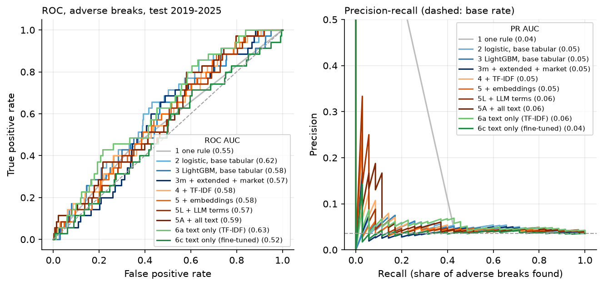
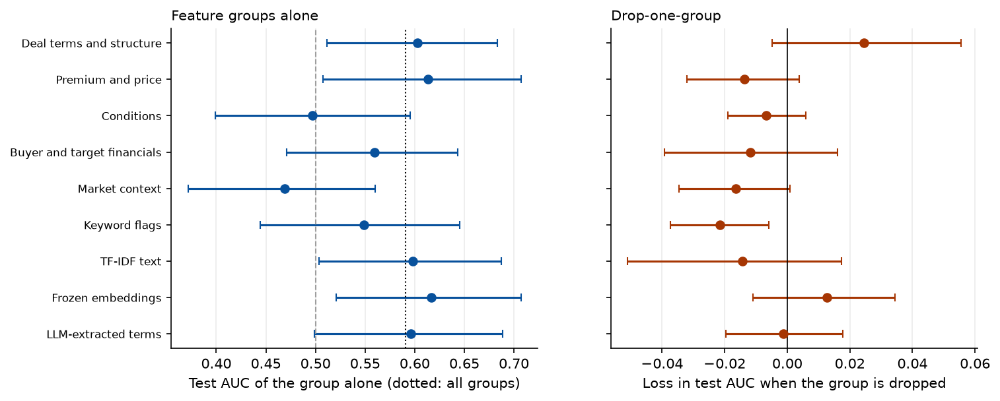
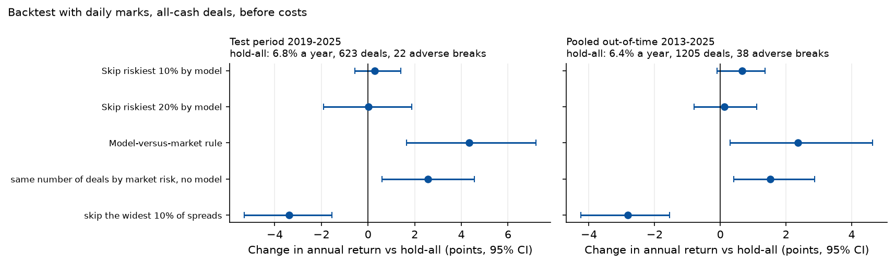

# Predicting M&A deal breaks at announcement

MIT 15.071, Project 1 (Predictive AI). Solo project by Lorenz J. Brodt.
Code and full results: <https://github.com/lorenzjbrodt/merger-deal-break-prediction>

## Problem

A merger-arbitrage fund buys the target's shares after a deal is announced. If the deal closes, it earns a spread of a few
percent. If the deal breaks, it loses many times that. The portfolio manager has to decide on day one whether to take the
position and how large. This project asks how well the break can be predicted from what is known on the announcement day.

## Approach

- **Deals.** 4,744 signed US public M&A deals announced 2001-2025 from a Capital IQ screen (licensed; not redistributed).
- **Target.** Not every cancelled deal hurts an arbitrageur. Of 346 breaks, 100 were lost to a higher competing bid. The
  primary target is the **adverse break** (246 cases): cancelled for any other reason. Reasons were read from deal notes
  by an LLM, cross-checked with rules, and 50 cases were re-read by hand.
- **Sample.** 276 deals are reverse mergers, mostly de-SPACs from 2020 onward. They are not arbitrage situations and are
  excluded from the primary sample (4,468 deals).
- **Inputs.** Deal terms, buyer and target financials, market conditions, the press release and merger agreement from SEC
  EDGAR (TF-IDF, sentence embeddings, a fine-tuned encoder, and 29 contract terms extracted by an LLM and validated
  against a stronger model), and the target's daily share price from CRSP (via WRDS).
- **Evaluation.** Train on 2001-2018, test on 2019-2025. Everything fitted inside the training period. A second,
  larger evaluation set pools 2013-2025, with every year scored by models refitted on earlier years only. Bootstrap
  confidence intervals. Ablations, calibration, SHAP, a label audit against SEC filings, and a backtest on daily prices.

## Results

Test period 2019-2025, primary sample: 1,083 deals, 40 adverse breaks.

| Model | ROC AUC [95% CI] | Adverse breaks found in the riskiest 20% of deals |
|---|---|---|
| Base rate | 0.500 | 20% |
| One rule (any stock in the consideration) | 0.528 [0.449, 0.606] | 23% |
| Logistic regression, base deal terms | 0.606 [0.523, 0.694] | 28% |
| LightGBM, base deal terms | 0.628 [0.538, 0.713] | 40% |
| LightGBM + extended buyer, target and structure features (final model) | 0.633 [0.551, 0.717] | 35% |
| + market context | 0.626 [0.545, 0.709] | 33% |
| + text (keywords, embeddings, LLM-extracted terms) | 0.646 [0.559, 0.730] | 33% |
| Market-implied probability on day 1 (623 priced cash deals, 22 breaks) | 0.643 [0.523, 0.755] | 27% |

**1. The signal is real and weak.** Deal terms rank adverse breaks better than chance. In the pooled out-of-time set
(2013-2025: 2,176 deals, 84 adverse breaks) the final model reaches an AUC of 0.609 [0.538, 0.686]. The model keys on
financial weakness and structure: weak target and acquirer share prices, all-stock consideration, deal size relative to
the buyer.

**2. More data did not help.** Extended features, market context, text and LLM-extracted contract terms each change the
AUC by an amount whose interval includes zero, in the test period and in the pooled set with twice as many breaks. A
fine-tuned text encoder performs at chance. Announcements are written by the deal parties and read alike whether or not
the deal later breaks.

**3. The market ranks breaks better than the model.** One trading day after the announcement, the market-implied break
probability from the spread reaches an AUC of 0.72 [0.64, 0.80] in the pooled set (1,205 priced all-cash deals, 38
adverse breaks) against 0.60 [0.48, 0.70] for the model. Adding the model to the market changes the AUC by
-0.03 [-0.19, +0.11].

**4. In dollars.** Backtest on CRSP daily prices, all-cash deals, entry at the day-1 close, before costs. Holding every
deal returned 6.8% a year in the test period and 6.4% in the pooled set. Skipping the model's riskiest 10% changes that
by +0.3 points [-0.6, +1.4] (pooled +0.7 [-0.1, +1.4]). A rule that skips deals where the model sees more risk than the
market adds +4.3 points [+1.6, +7.2] (pooled +2.4 [+0.3, +4.6]), but it mostly holds wide spreads, which earned more
anyway. Against a model-free rule holding the same number of deals the gain is +1.8 [-0.3, +4.4] (pooled +0.8 [-1.0, +2.9]).

**5. Definitions and data matter more than models.** A first pass that counted every cancelled deal as a break reached
an AUC of 0.62 to 0.70, much of it from telling de-SPACs and topped deals apart from ordinary mergers. And the vendor
stores the final offer: for deals that were later bumped, the day-1 spread looked like 30% or more until the
announcement-day offer was read from the press release.

## Limitations

- **Few events.** 40 adverse breaks in the test period (22 priced all-cash) and 84 in the pooled set (38 priced).
  Intervals are wide, and "no measurable gain" does not mean "no gain".
- **Licensed vendor data.** Results can be rebuilt only with Capital IQ and WRDS access. The vendor fills fewer fields
  for cancelled deals, stores final terms, and 15% of breaks have no stated reason. An audit of 80 deal statuses against
  SEC filings found 3 of 76 checkable ones contradicted.
- **Backtest.** No transaction or financing costs, equal weights, unlimited capacity, every deal bought at the day-1
  close.
- **Blind spot.** The model cannot see competitive overlap, which drives antitrust blocks and the largest losses.
- **LLM caveat.** An exploratory zero-shot LLM score ranked deals far better (AUC 0.82), but the same LLM could name 92%
  of the anonymised targets, so it may simply know how the deals ended. It is not used anywhere.

## Repository

<https://github.com/lorenzjbrodt/merger-deal-break-prediction>: code, result tables, figures, a synthetic sample to
run the pipeline without a licence, a decision log and a local Streamlit demo. No row-level Capital IQ, CRSP or
Compustat data is published.
