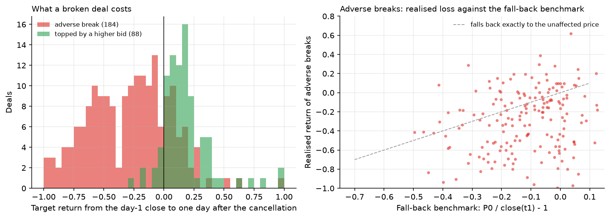

# Underwriting merger deals at announcement

MIT 15.071, Project 1 (Predictive AI). Solo project by Lorenz J. Brodt.
Code and full results: <https://github.com/lorenzjbrodt/merger-deal-break-prediction>

**Result.** AI improves deal timing and ranking but does not beat the market price on break risk, and breaks cost far
more than assumed. The closing date error is 47.10 days against 63.52 for the median by deal type. On break risk the
model does not beat the day-1 spread: its AUC is 0.60 against 0.72 on the same deals, a gap of -0.12 AUC [-0.28 to
+0.005] that is not significant at 95%. LLM-read contract terms cut the timing error and do not measurably improve break
risk. Adverse breaks lose 27.94% on average (historical average of 184 breaks), 2.62x the 10.67% fallback assumption.

**Recommendation.** Use the model for timing and ranking, the spread for break risk, and a 31% loss estimate for sizing.
Ranked by expected annualized return, the top third earned 12.26% a year, $1.67m per $100m a year more than the top
third by annualized spread [0.20 to 3.25], before costs. Positions are sized for 31.21%, the mean loss of the 38 adverse
breaks among ranked deals.

## Problem

A merger arbitrage fund buys the target’s shares after a takeover announcement, and the portfolio manager decides
whether and how much to invest; the spread is earned only if the deal closes. At the median a position earns 1.39% when
the deal closes (95.44% of deals) and loses 28.91% in an adverse break (3.15%), about 21 times as much (1,205 priced
all-cash deals announced 2013 to 2025). Three estimates decide its value: the time to closing, the break risk, and the
loss if a deal breaks. This project asks how well each can be predicted from what is known at announcement, and whether
ranking deals by the expected annualized return they imply makes money out of sample.

## Data and methodology

- **Deals.** 4,744 signed US public M&A deals announced 2001 to 2025 from a Capital IQ screen (licensed; not
  redistributed). Of 346 cancellations, 100 were lost to a higher competing bid, which is a gain for the fund; the
  target is the **adverse break** (246 cases). 276 reverse mergers (mostly de-SPACs) are excluded, which leaves 4,468
  deals with 198 adverse breaks. The vendor stores the final offer, so 247 offers were reset to the announcement-day
  offer from the press release.
- **Inputs.** Deal terms, buyer and target financials, and market conditions; the press release from SEC EDGAR, which
  Claude Haiku reads into 29 contract terms plus the parties’ stated closing date; daily share prices from CRSP;
  product similarity of buyer and target (Hoberg-Phillips).
- **Models and tests.** Time to closing: boosted trees on deal, firm, and LLM data, trained on 2001 to 2018 and tested
  on 1,026 completed deals announced 2019 to 2025, against the median by deal type and the parties’ stated date. Break
  risk: boosted trees on deal terms and financials, refitted each year on all earlier years and tested on 1,205 priced
  all-cash deals announced 2013 to 2025, against the day-1 spread. Loss if a deal breaks: the historical average, since
  no model beat it reliably, checked on 184 adverse breaks with prices (of the 198), 2001 to 2025 with one year left out
  at a time, against the fallback assumption.
- **Ranking.** The three estimates give each deal’s expected annualized return, which ranks the deals each year on
  earlier years only. In the ranking, break risk comes from a day-1 price model in 7 of 13 years (picked by
  cross-validation on prior years), else the spread. Positions are entered at the close one trading day after the
  announcement; returns are before costs. Intervals are bootstrap 95% intervals.

## Results

### 1. Time to closing: the model beats the median by deal type and the parties’ stated date

The median completed deal takes 107 days. Without the parties’ stated closing date the model’s closing date error is
52.68 days [48.08 to 57.40] in the test period against 63.52 for the median by deal type; on the 807 deals that state a
date it is as accurate as that date (46.86 against 46.43 days). With the stated date the model reaches 47.10 days [42.95
to 51.49] over all 1,026 deals (43.13 pooled) and beats the stated date by 6.61 days [3.86 to 9.51]; deals closed a
median of 14.50 days before it. The contract terms read by the LLM cut the error by 1.55 days [-2.55 to -0.60]. The
calibrated 80% interval contains 80.31% of test-period deals.

### 2. Break risk: the model does not beat the day-1 spread

| Adverse breaks, ROC AUC [95% interval] | Test 2019 to 2025 | Pooled out-of-time 2013 to 2025 |
|---|---|---|
| Logistic regression, base deal terms | 0.606 [0.523 to 0.694] | 0.590 [0.525 to 0.651] |
| Final model (LightGBM, extended features) | 0.633 [0.551 to 0.717] | 0.609 [0.538 to 0.686] |
| + text (keywords, embeddings, and LLM terms) | 0.646 [0.559 to 0.730] | 0.599 [0.540 to 0.663] |
| Day-1 spread, as a market-implied probability (priced all-cash deals) | 0.643 [0.523 to 0.755] | 0.721 [0.642 to 0.800] |
| Final model on the same deals | 0.632 [0.519 to 0.734] | 0.599 [0.476 to 0.702] |

Test: 1,083 deals, 40 adverse breaks (623 priced all-cash, 22 breaks). Pooled: 2,176 deals, 84 adverse breaks (1,205
priced, 38 breaks). On the 1,205 priced deals the model’s AUC is 0.599 against 0.721 for the day-1 spread, a gap of
-0.12 AUC [-0.28 to +0.005] that is not significant at 95%, so the model does not beat the spread. More data does not
reliably help: buyer and target financials, press release text and LLM-read terms, product overlap, market conditions,
and ten further day-1 market signals each change the AUC by an amount whose interval includes zero or is negative. The
LLM-read terms improve timing (section 1) but not break risk. The model keys on financial weakness and deal structure
and is blind to what blocks clean cash deals.

### 3. Loss if a deal breaks: far larger than the fallback assumption

From the day-1 close to the day after the cancellation, adverse breaks lost 27.94% on average (184 deals), with a tenth
of them losing more than 73.01%. The fallback assumption, a return to the pre-announcement price, implies only 10.67%.
No loss forecast reliably beats the historical average when every year is predicted from the others. Among the ranked
deals the 38 adverse breaks lost 31.21% on average, which is the loss used for sizing.

### 4. Impact: ranking by expected annualized return

Combining the three estimates per deal and sorting each year’s all-cash deals into thirds (pooled 2013 to 2025, 1,205
deals): the top third earned 12.26% a year, the middle 3.07%, and the bottom 2.25%; top minus bottom +10.01 points
[+6.51 to +13.95] (test period +12.62 [+5.31 to +20.33]). A simple free benchmark is the annualized spread, the day-1
spread divided by the median time to closing by deal type; its top third earned 10.58% a year. The model’s top third
beats it by 1.67 points [+0.20 to +3.25], or $1.67m a year per $100m, and beats the top third by raw spread by 2.48
points [+0.95 to +4.14]. In a daily calendar-time portfolio the top half by the model returned 9.57% a year with a
Sharpe ratio of 0.80, the top half by raw spread 8.70% and 0.77, and all deals 7.19% and 0.72; the edge over the raw
spread, +0.87 points [-0.88 to +2.60], is not confirmed.

### 5. Recommendation

Use the model for timing and ranking, the spread for break risk, and a 31% loss estimate for sizing: annualize each
spread with the forecast, read break risk from the spread, size each position for 31.21%, and rank by expected
annualized return. The model’s top third holds 22 of the 38 priced adverse breaks, against 26 for the top third by
annualized spread, so part of its return is pay for bearing break risk. Next step: run the ranking alongside the current
process, with an agent underwriting each new deal (Project 2), and invest once live results confirm the edge.

## Limitations

- **Few events.** 40 adverse breaks in the test period (22 priced all-cash) and 84 in the pooled set (38 adverse breaks
  among ranked deals). Intervals are wide, and “no measurable gain” does not mean “no gain”. Pooled intervals resample
  only 13 years.
- **Before costs.** No transaction or financing costs, equal weights, unlimited capacity, and every deal bought at the
  day-1 close.
- **Break risk in the backtest.** A day-1 price model gave break risk in 7 of 13 backtest years; the daily-portfolio
  edge is not confirmed.
- **Licensed vendor data.** The real results can be rebuilt only with Capital IQ and WRDS access; the synthetic sample
  only checks that the code runs. The vendor fills fewer fields for canceled deals, stores final terms, and 15% of
  breaks have no stated reason. An audit of 80 deal statuses against SEC filings found 3 of 76 checkable ones
  contradicted.
- **LLM caveat.** An exploratory zero-shot LLM score ranked deals far better (AUC 0.82), but the same LLM named 92% of
  the anonymized targets, so it may already know the outcome. It is not used anywhere.

## Repository

<https://github.com/lorenzjbrodt/merger-deal-break-prediction>: code, result tables, figures, a synthetic sample to
run the pipeline without a license, a decision log, and a local Streamlit demo. No row-level Capital IQ, CRSP, or
Compustat data is published.
