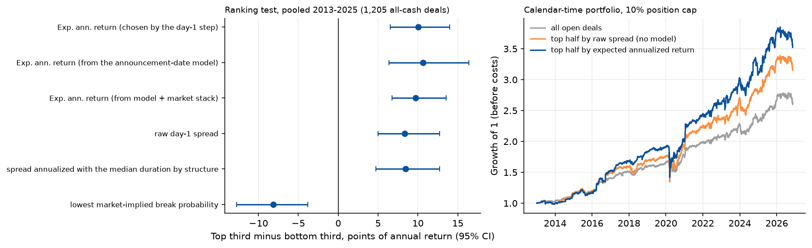

# Underwriting merger deals at announcement

MIT 15.071, Project 1 (Predictive AI). Solo project by Lorenz J. Brodt.
Code and full results: <https://github.com/lorenzjbrodt/merger-deal-break-prediction>

**Result.** Of the three numbers a merger-arbitrage manager underwrites, only time to closing is predicted well at
announcement (off by 47 days on average, against 64 for the median of its deal type); break risk is judged better by the market's
spread than by any model here, and the loss when a deal breaks is large (28% on average) and close to unpredictable.
**Recommendation.** Use the model for timing and ranking, the spread for break risk and a 31% loss for sizing: turn
each spread into an expected annualized return with the time-to-closing model and rank deals by it (top third 12.3% a
year, bottom third 2.2%, before costs), read break risk off the spread, and size positions for a 31% loss, the mean
loss of the 38 adverse breaks among the ranked all-cash deals (31.21%; 27.94% over all 184 adverse breaks), not on
the break model.

## Problem

A merger-arbitrage fund buys the target's shares after a deal is announced. If the deal closes, it earns about 1.4% at
the median; if it breaks adversely, it loses about 21 times that (1,205 priced all-cash deals announced 2013-2025). For every deal the portfolio manager underwrites three numbers:
the probability of an adverse break, the time to closing, and the loss if it breaks. This project asks how well each can
be predicted from what is known at announcement, and whether ranking deals by the expected annualized return they imply
makes money out of sample.

## Approach

- **Deals.** 4,744 signed US public M&A deals announced 2001-2025 from a Capital IQ screen (licensed; not redistributed).
- **Cleaning the question.** Of 346 breaks, 100 were lost to a higher competing bid, which is good news for an
  arbitrageur. The target is the **adverse break** (246 cases). 276 reverse mergers (mostly de-SPACs) are excluded, which leaves 4,468 deals with 198 adverse breaks. The
  vendor stores the final offer, so the announcement-day offer is read from the press release.
- **Inputs.** Deal terms, buyer and target financials, market conditions; the press release and merger agreement from SEC
  EDGAR, read by an LLM into 29 validated contract terms and the parties' stated expected closing; daily share prices
  from CRSP; product similarity of buyer and target (Hoberg-Phillips).
- **Evaluation.** Train on 2001-2018, test on 2019-2025. A second, larger set pools 2013-2025, with every year scored by
  break and timing models refitted on earlier years only; loss forecasts are compared leave-one-year-out. Bootstrap
  confidence intervals throughout. Positions are entered at the close one trading day after the announcement; returns
  are before costs.

## Results

### 1. Break probability: weak, and the market does it better

| Adverse breaks, ROC AUC [95% CI] | Test 2019-2025 | Pooled out-of-time 2013-2025 |
|---|---|---|
| Logistic regression, base deal terms | 0.606 [0.523, 0.694] | 0.590 [0.525, 0.651] |
| Final model (LightGBM, extended features) | 0.633 [0.551, 0.717] | 0.609 [0.538, 0.686] |
| + text (keywords, embeddings, LLM terms) | 0.646 [0.559, 0.730] | 0.599 [0.540, 0.663] |
| Market-implied probability, day 1 (priced all-cash deals) | 0.643 [0.523, 0.755] | 0.721 [0.642, 0.800] |
| Final model on the same deals | 0.632 [0.519, 0.734] | 0.599 [0.476, 0.702] |

Test: 1,083 deals, 40 adverse breaks (623 priced all-cash, 22 breaks). Pooled: 2,176 deals, 84 adverse breaks (1,205
priced, 38 breaks). Extended features, text, LLM-extracted terms, product overlap and ten further day-1 market signals
each change the AUC by an amount whose interval includes zero or is negative. The model keys on financial weakness and
deal structure and is blind to what blocks clean cash deals.

### 2. Time to closing: predictable

The median completed deal takes 107 days. Without the parties' guidance the model's mean absolute error is 52.7 days
[48.1, 57.4] in the test period against 63.5 for the median by structure (tender offer or merger); that is as accurate
as the closing date the parties state themselves (46.9 against 46.4 days on the same deals). The product forecast also
reads that guidance where it is stated and reaches 47.1 days [43.0, 51.5] over all deals (43.1 pooled), 6.6 days better
than the guidance alone [-9.5, -3.9]. LLM-extracted contract terms cut the error by 1.6 days [-2.6, -0.6]; text
embeddings add nothing. The 80% interval, calibrated on training years only, contains 80% of test-period deals.

### 3. Loss if it breaks: large and barely predictable

From the day-1 close to the day after the cancellation, adverse breaks lost 28% on average (184 deals), with a tenth of
them losing more than 73%. A fallback to the pre-announcement price would imply only 11%. No forecast beats the
historical average when every year is predicted from the others.

### 4. In dollars: ranking by expected annualized return

Combining the three numbers per deal and sorting each year's all-cash deals into thirds (pooled 2013-2025, 1,205 deals):
the top third earned 12.3% a year, the middle 3.1%, the bottom 2.2%; top minus bottom +10.0 points [+6.5, +13.9] (test
period +12.6 [+5.3, +20.3]). The raw spread alone gives +8.4 [+5.0, +12.7]. The model's top third beats the spread's top
third by 2.48 points [+0.95, +4.14], or $2.48m a year per $100m. In a daily calendar-time portfolio the top half by the
model returned 9.6% a year with a Sharpe ratio of 0.80, the top half by raw spread 8.7% and 0.77, all deals 7.2% and
0.72; model minus spread +0.9 points [-0.9, +2.6].

### 5. What to take from it

Annualize spreads with the duration model, read break risk off the spread, and size positions for a 31% loss, the
mean loss of the 38 adverse breaks among the ranked all-cash deals (31.21%; 27.94% over all 184 adverse breaks), not
on the break model. Most of the ranking profit is a risk premium: the top third holds 22 of the 38 adverse breaks.

## Limitations

- **Few events.** 40 adverse breaks in the test period (22 priced all-cash) and 84 in the pooled set (38 priced).
  Intervals are wide, and "no measurable gain" does not mean "no gain". Pooled intervals resample only 13 years.
- **Before costs.** No transaction or financing costs, equal weights, unlimited capacity, every deal bought at the day-1
  close.
- **Licensed vendor data.** Results can be rebuilt only with Capital IQ and WRDS access. The vendor fills fewer fields
  for cancelled deals, stores final terms, and 15% of breaks have no stated reason. An audit of 80 deal statuses against
  SEC filings found 3 of 76 checkable ones contradicted.
- **LLM caveat.** An exploratory zero-shot LLM score ranked deals far better (AUC 0.82), but the same LLM could name 92%
  of the anonymised targets, so it may simply know how the deals ended. It is not used anywhere.

## Repository

<https://github.com/lorenzjbrodt/merger-deal-break-prediction>: code, result tables, figures, a synthetic sample to
run the pipeline without a licence, a decision log and a local Streamlit demo. No row-level Capital IQ, CRSP or
Compustat data is published.
