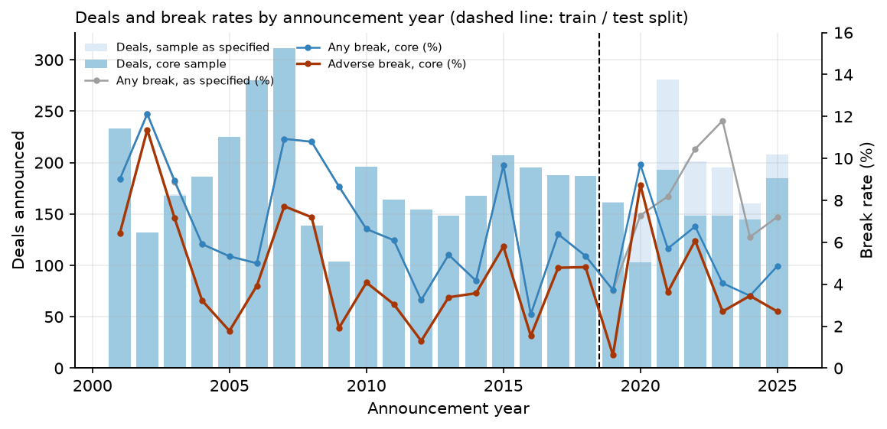

# Predicting M&A deal breaks at announcement

MIT 15.071, Project 1 (Predictive AI). Solo project by Lorenz J. Brodt.
Code and full results: <https://github.com/lorenzjbrodt/merger-deal-break-prediction>

## Problem

A merger-arbitrage fund buys the target's shares after a deal is announced. If the deal closes, it earns a spread of a few
percent. If the deal breaks, it loses many times that. The portfolio manager has to decide on day one whether to take the
position and how large. This project asks how well the break can be predicted from what is known on the announcement day.

## Approach

- **Deals.** 4,744 signed US public M&A deals announced 2001-2025 from a Capital IQ screen (licensed; not redistributed).
- **Target.** Not every cancelled deal hurts an arbitrageur. Of 346 breaks, 100 were lost to a higher competing bid. The
  primary target is the **adverse break** (246 cases): cancelled for any other reason. Reasons were read from deal notes
  by an LLM, cross-checked with rules, and 50 cases were re-read by hand.
- **Sample.** 276 deals are reverse mergers, mostly de-SPACs from 2020 onward. They are not arbitrage situations and are
  excluded from the primary sample (4,468 deals).
- **Inputs.** Deal terms, buyer and target financials, market conditions, the press release and merger agreement from SEC
  EDGAR (TF-IDF, sentence embeddings, a fine-tuned encoder, and 29 contract terms extracted by an LLM and validated
  against a stronger model), and the target's share price after announcement.
- **Evaluation.** Train on 2001-2018, test on 2019-2025. Everything fitted inside the training period. Bootstrap
  confidence intervals. Rolling-origin checks, ablations, calibration, SHAP, a label audit against SEC filings, and a
  backtest on monthly prices.

## Results

Test period 2019-2025, primary sample: 1,083 deals, 40 adverse breaks.

| Model | ROC AUC [95% CI] | Adverse breaks found in the riskiest 20% of deals |
|---|---|---|
| Base rate | 0.500 | 20% |
| One rule (any stock in the consideration) | 0.528 [0.449, 0.606] | 23% |
| Logistic regression, base deal terms | 0.606 [0.523, 0.694] | 28% |
| LightGBM, base deal terms | 0.628 [0.538, 0.713] | 40% |
| LightGBM + extended buyer, target and structure features (final model) | 0.633 [0.551, 0.717] | 35% |
| + market context | 0.626 [0.545, 0.709] | 33% |
| + text (keywords, embeddings, LLM-extracted terms) | 0.646 [0.559, 0.730] | 33% |
| Market-implied probability from the spread (552 priced cash deals, 16 breaks) | 0.619 [0.458, 0.771] | 25% |

**1. The signal is real and weak.** Deal terms rank adverse breaks better than chance, and that holds across twelve
rolling train/test windows (mean AUC 0.61 to 0.65). The model keys on financial weakness and structure: weak target and
acquirer share prices, all-stock consideration, deal size relative to the buyer.

**2. More data did not help.** Extended features, market context, text and LLM-extracted contract terms each change the
AUC by an amount whose interval includes zero. A fine-tuned text encoder performs at chance. Announcements are written by
the deal parties and read alike whether or not the deal later breaks.

**3. The model does not demonstrably beat the market.** The break probability implied by the spread is about as
informative as the model. Combining them adds +0.027 AUC [-0.096, +0.153].

**4. In dollars.** In a backtest on monthly closes (all-cash deals, before costs), holding every priced deal returned 8.7%
a year on deployed capital. Skipping the model's riskiest 10% changes that by +0.9 points [-0.3, +2.0]; skipping the
riskiest 20% by +0.5 [-1.5, +2.5].

**5. Definitions matter more than models.** A first pass that counted every cancelled deal as a break reached an AUC of
0.62 to 0.70. Much of that came from telling de-SPACs and topped deals apart from ordinary mergers, which is not the risk
the portfolio manager is paid to judge.

## Limitations

- **Few events.** 40 adverse breaks in the test period and 16 with usable cash-deal prices. Intervals are wide, and
  "no measurable gain" does not mean "no gain".
- **Licensed vendor data.** Results can be rebuilt only with Capital IQ access. The vendor fills fewer fields for
  cancelled deals, may store revised terms, and 15% of breaks have no stated reason. An audit of 80 deal statuses against
  SEC filings found 3 of 76 checkable ones contradicted.
- **Monthly prices.** Entry is up to a month after announcement; no transaction costs, dividends or financing. A few
  deals with very wide spreads in March 2020 dominate average returns.
- **Blind spot.** The model cannot see competitive overlap, which drives antitrust blocks and the largest losses.
- **LLM caveat.** An exploratory zero-shot LLM score ranked deals far better (AUC 0.82), but the same LLM could name 92%
  of the anonymised targets, so it may simply know how the deals ended. It is not used anywhere.

## Repository

<https://github.com/lorenzjbrodt/merger-deal-break-prediction>: code, result tables, figures, a synthetic sample to
run the pipeline without a licence, a decision log and a local Streamlit demo. No row-level Capital IQ data is published.
